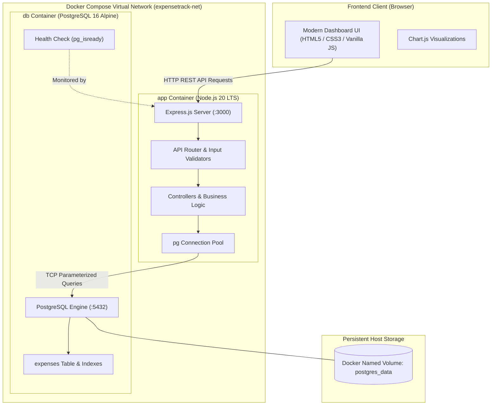

# ExpenseTrack — Personal Expense Management System

A production-conscious, full-stack financial expense tracking web application designed for a college **Cloud and DevOps** mini project. Built with **Node.js**, **Express.js**, **PostgreSQL**, and containerized with **Docker** and **Docker Compose**, with CI automation powered by **GitHub Actions**.

---

## 1. Project Overview

**ExpenseTrack** is a clean, responsive personal expense management system inspired by modern SaaS financial dashboards. It enables users to record, monitor, categorize, and analyze their personal expenditures in Indian Rupees (₹) with real-time analytics and visual charts.

Unlike frontend mockups or toy projects, ExpenseTrack uses a real PostgreSQL relational database with parameterized queries, schema auto-migration, transaction management, and connection resilience.

---

## 2. Project Objectives

- **Cloud & DevOps Education**: Demonstrate containerization, microservice orchestration, named volume persistence, and continuous integration workflows.
- **Production Best Practices**: Implement environment-based configuration, structured logging, defensive input validation, non-root container users, and health check monitoring.
- **Full-Stack Proficiency**: Build an end-to-end REST API architecture integrated with an interactive Vanilla JavaScript frontend and Chart.js visualizations.
- **Data Integrity**: Enforce strict database constraints (e.g., `CHECK (amount > 0)`), indexes for query acceleration, and SQL injection prevention via parameterized queries.

---

## 3. Features

- **Summary Dashboard**:
  - Total Lifetime Expenses (dynamic sum from PostgreSQL).
  - Current Month Expenses (dynamic sum for active calendar month).
  - Highest Spending Category (calculated via SQL aggregation).
  - Total Transactions count.
- **Interactive Visualizations**:
  - 6-Month Spending Trend Bar Chart (via Chart.js).
  - Category-Wise Spending Doughnut Chart with percentage distributions.
- **Full CRUD Operations**:
  - **Add Expense**: Modal form with validation for title, amount (> 0), category, date, payment method, and description.
  - **View Expenses**: Paginated tabular display formatted in Indian Rupees (₹) and localized dates.
  - **Edit Expense**: Pre-filled update modal with validation.
  - **Delete Expense**: Two-step deletion confirmation modal to prevent accidental data loss.
- **Search, Filter & Sorting**:
  - Live search by title or description keyword.
  - Filter by Category (Food, Transportation, Education, Shopping, Entertainment, Healthcare, Bills, Other).
  - Filter by Payment Method (Cash, UPI, Debit Card, Credit Card, Bank Transfer, Other).
  - Filter by Date Range (From Date to To Date).
  - Sort by Newest, Oldest, Highest Amount, or Lowest Amount.
- **Category Analytics View**:
  - Detailed breakdown cards showing expenditure sum, transaction count, percentage progress bars, and one-click filtering.
- **Monthly Reports View**:
  - Filter by specific month and year.
  - Displays monthly total, transaction volume, and daily average.
  - One-click **Export to CSV** feature for reporting and offline analysis.
- **Health Probing**:
  - Real-time `/api/health` status check with live status indicator dot in the sidebar footer.

---

## 4. Technology Stack

- **Frontend**:
  - HTML5 (Semantic, accessible markup)
  - CSS3 (Responsive grid and flexbox, custom modern SaaS theme)
  - Vanilla JavaScript (Clean ES6+ DOM manipulation and fetch API)
  - [Chart.js 4.4](https://www.chartjs.org/) (Interactive charts)
  - [Lucide Icons](https://lucide.dev/) (Minimalist SVG icons)
- **Backend**:
  - [Node.js](https://nodejs.org/) (LTS runtime)
  - [Express.js](https://expressjs.com/) (RESTful routing and middleware)
  - [pg (node-postgres)](https://node-postgres.com/) (Official PostgreSQL client with connection pooling)
  - [dotenv](https://github.com/motdotla/dotenv) (Environment management)
  - [cors](https://github.com/expressjs/cors) (Cross-Origin Resource Sharing)
- **Database**:
  - [PostgreSQL 16](https://www.postgresql.org/) (Relational database management system)
- **DevOps & Containers**:
  - Docker & Docker Compose
  - Multi-stage / lightweight Alpine images
  - Docker named volume for persistent storage
  - GitHub Actions for Continuous Integration (CI)

---

## 5. Architecture Diagram



---

## 6. Project Folder Structure

```
Expense Tracker - cloud/
├── public/                       # Static frontend assets
│   ├── index.html                # Single-page application dashboard
│   ├── css/
│   │   └── style.css             # SaaS styled CSS design
│   └── js/
│       └── app.js                # Frontend client logic & Chart.js controllers
├── src/                          # Backend source code
│   ├── config/
│   │   └── database.js           # PostgreSQL pool & auto schema migration
│   ├── controllers/
│   │   ├── expenseController.js  # Expense CRUD controller
│   │   └── reportController.js   # Analytics and monthly report controller
│   ├── middleware/
│   │   ├── errorHandler.js       # Safe global error & 404 middleware
│   │   └── validation.js         # Input validation & parameter sanitization
│   ├── routes/
│   │   ├── expenseRoutes.js      # /api/expenses routes
│   │   └── reportRoutes.js       # /api/reports routes
│   ├── services/
│   │   ├── expenseService.js     # Parameterized database queries
│   │   └── reportService.js      # Aggregation and analytics queries
│   └── app.js                    # Express application assembly
├── tests/                        # Automated unit and integration tests
│   ├── health.test.js            # Health check tests
│   └── expense.test.js           # CRUD & input validation tests
├── .github/
│   └── workflows/
│       └── ci.yml                # GitHub Actions Continuous Integration
├── .dockerignore                 # Files excluded from Docker builds
├── .gitignore                    # Files excluded from Git version control
├── .env.example                  # Template configuration environment file
├── .env                          # Local environment variables
├── Dockerfile                    # Container definition for Node.js backend
├── compose.yaml                  # Multi-container orchestration specification
├── package.json                  # Dependencies and NPM scripts
├── server.js                     # Application entry point with DB retry
└── README.md                     # Comprehensive project documentation
```

---

## 7. Prerequisites

Before running the project, verify that the following tools are installed:

- **Node.js** (v18 or higher recommended; v20 LTS preferred)
- **npm** (v9 or higher)
- **Git** (v2.x or higher)
- **Docker Desktop** (or Docker Engine + Docker Compose v2)

---

## 8. Local Development Setup (Without Docker)

If you prefer to run the application directly on your local machine:

1. **Clone or navigate to the project directory**:
   ```bash
   cd "d:/Expense Tracker - cloud"
   ```

2. **Install project dependencies**:
   ```bash
   npm install
   ```

3. **Configure Environment Variables**:
   Copy `.env.example` to `.env`:
   ```bash
   cp .env.example .env
   ```
   Edit `.env` to match your local PostgreSQL configuration:
   ```env
   PORT=3000
   NODE_ENV=development
   DB_HOST=localhost
   DB_PORT=5432
   DB_NAME=expensetrack
   DB_USER=postgres
   DB_PASSWORD=your_postgres_password
   ```

4. **Start the local PostgreSQL server and create database**:
   ```sql
   CREATE DATABASE expensetrack;
   ```

5. **Start the application**:
   ```bash
   npm start
   ```
   Or in development watch mode:
   ```bash
   npm run dev
   ```

6. The application will automatically create the `expenses` table and required indexes upon startup.

---

## 9. PostgreSQL Configuration

The application automatically verifies and provisions the required schema when starting up:

```sql
CREATE TABLE IF NOT EXISTS expenses (
  id SERIAL PRIMARY KEY,
  title VARCHAR(150) NOT NULL,
  amount NUMERIC(12, 2) NOT NULL CHECK (amount > 0),
  category VARCHAR(50) NOT NULL,
  expense_date DATE NOT NULL,
  payment_method VARCHAR(50),
  description TEXT,
  created_at TIMESTAMPTZ DEFAULT CURRENT_TIMESTAMP,
  updated_at TIMESTAMPTZ DEFAULT CURRENT_TIMESTAMP
);

CREATE INDEX IF NOT EXISTS idx_expenses_date ON expenses(expense_date);
CREATE INDEX IF NOT EXISTS idx_expenses_category ON expenses(category);
CREATE INDEX IF NOT EXISTS idx_expenses_created_at ON expenses(created_at);
```

Supported categories:
- `Food`, `Transportation`, `Education`, `Shopping`, `Entertainment`, `Healthcare`, `Bills`, `Other`

Supported payment methods:
- `Cash`, `UPI`, `Debit Card`, `Credit Card`, `Bank Transfer`, `Other`

---

## 10. Docker Installation Requirements

To use Docker containerization, ensure:
- **Windows / macOS**: [Docker Desktop](https://www.docker.com/products/docker-desktop/) installed and running with WSL 2 backend (on Windows).
- **Linux**: Docker Engine (`docker-ce`) and Docker Compose plugin (`docker-compose-plugin`) installed.
- Ensure ports `3000` is free on your host machine.

---

## 11. Docker Image Build Instructions

To manually build the application Docker image:

```bash
docker build -t expensetrack-app:latest .
```

The build utilizes Docker layer caching, installs only production dependencies (`npm ci --omit=dev`), and enforces the non-root `node` user.

---

## 12. Docker Compose Startup Instructions

Docker Compose orchestrates both the PostgreSQL database container and the Express application container within an isolated bridge network (`expensetrack-net`).

### Build and Start Containers in Background:
```bash
docker compose up --build -d
```

### View Running Containers:
```bash
docker compose ps
```

### View Application Logs:
```bash
docker compose logs -f app
```

### View Database Logs:
```bash
docker compose logs -f db
```

---

## 13. Instructions to Open Application in a Browser

Once the containers or local server are running:

1. Open your web browser (Chrome, Edge, Firefox, Safari).
2. Navigate to:
   ```
   http://localhost:3000
   ```
3. You will see the **ExpenseTrack** dashboard.
4. Verify the database status badge at the bottom-left of the sidebar displays:
   `● Database: Connected`

---

## 14. Instructions to Stop Containers

To gracefully stop the running application and database containers:

```bash
docker compose down
```

This stops and removes the containers and network while **safely keeping your database data intact** inside the named volume.

---

## 15. Instructions to Remove Containers While Preserving Database Data

- When you run:
  ```bash
  docker compose down
  ```
  The named volume `postgres_data` is **preserved**. When you start the containers again with `docker compose up -d`, all previously recorded expenses remain intact.

> [!WARNING]
> Running `docker compose down -v` removes the named volumes alongside the containers. This will **permanently delete** all stored expense records from PostgreSQL. Avoid using the `-v` flag unless you intend to completely reset the database.

---

## 16. Git and GitHub Setup Instructions

Follow these steps to initialize version control and push to GitHub:

### 1. Initialize local Git repository:
```bash
git init
```

### 2. Stage all project files:
```bash
git add .
```

### 3. Create initial commit:
```bash
git commit -m "Initial ExpenseTrack implementation"
```

### 4. Create repository on GitHub:
1. Log into your GitHub account at [https://github.com](https://github.com).
2. Click **New Repository**.
3. Name the repository `expensetrack` (or your preferred name).
4. Set visibility to **Public** (or Private).
5. Leave "Add a README", ".gitignore", and license **unchecked** (they are already included in this project).
6. Click **Create repository**.

### 5. Link and push to GitHub:
```bash
git branch -M main
git remote add origin https://github.com/<your-username>/expensetrack.git
git push -u origin main
```

---

## 17. API Endpoint Documentation

| Method | Endpoint | Description | Request Body / Parameters | Status Codes |
| :--- | :--- | :--- | :--- | :--- |
| `GET` | `/api/health` | Health probe & DB connectivity | None | `200` OK, `503` Degraded |
| `GET` | `/api/summary` | Dashboard summary metrics | None | `200` OK |
| `GET` | `/api/expenses` | Retrieve filtered/paginated expenses | `page`, `limit`, `search`, `category`, `payment_method`, `startDate`, `endDate`, `sortBy`, `sortOrder` | `200` OK |
| `GET` | `/api/expenses/:id` | Retrieve single expense by ID | URL parameter `:id` | `200` OK, `404` Not Found, `400` Invalid ID |
| `POST` | `/api/expenses` | Create new expense | `{ title, amount, category, expense_date, payment_method, description }` | `201` Created, `400` Validation Error |
| `PUT` | `/api/expenses/:id` | Update existing expense | `{ title, amount, category, expense_date, payment_method, description }` | `200` OK, `404` Not Found, `400` Validation Error |
| `DELETE`| `/api/expenses/:id` | Delete expense by ID | URL parameter `:id` | `200` OK, `404` Not Found, `400` Invalid ID |
| `GET` | `/api/reports/monthly` | 6-month spending trend | Query param `months` (default 6) | `200` OK |
| `GET` | `/api/reports/categories` | Category expenditure breakdown | None | `200` OK |
| `GET` | `/api/reports/month-detail` | Monthly report details | Query params `year`, `month` | `200` OK |

---

## 18. Troubleshooting Section

### Issue 1: "Database: Connecting..." or Database Disconnected
- **Cause**: PostgreSQL is not yet ready or credentials in `.env` are mismatched.
- **Fix**: Check `docker compose logs -f db` to confirm PostgreSQL is ready. The app has built-in connection retries and will connect automatically once PostgreSQL finishes starting up.

### Issue 2: Port 3000 already in use
- **Cause**: Another service is running on port 3000.
- **Fix**: Change `PORT=3001` in your `.env` or run:
  ```bash
  PORT=3001 docker compose up -d
  ```

### Issue 3: Docker daemon not running
- **Cause**: Docker Desktop is not started.
- **Fix**: Launch Docker Desktop from the Start menu or applications list and wait for the Docker engine status to show "running".

### Issue 4: Jest test execution
- Run the automated test suite anytime with:
  ```bash
  npm test
  ```

---

## 19. Screenshots

Place application screenshots here after launching the system:

### 1. Dashboard View
*(Captures 4 summary cards, spending trend bar chart, category doughnut chart, and recent transactions table)*
```
[Screenshot Placeholder: Dashboard View with live Chart.js metrics]
```

### 2. All Transactions View & Filtering
*(Captures search, category filter, payment method filter, and pagination)*
```
[Screenshot Placeholder: All Transactions Filterable Table]
```

### 3. Add & Edit Expense Modal
*(Captures modern modal dialog with validation)*
```
[Screenshot Placeholder: Add / Edit Expense Dialog]
```

### 4. Monthly Reports & CSV Export
*(Captures monthly analytics view and export action)*
```
[Screenshot Placeholder: Monthly Reports & CSV Export View]
```

---

## License

This project is licensed under the MIT License — open for academic, educational, and personal project demonstrations.
